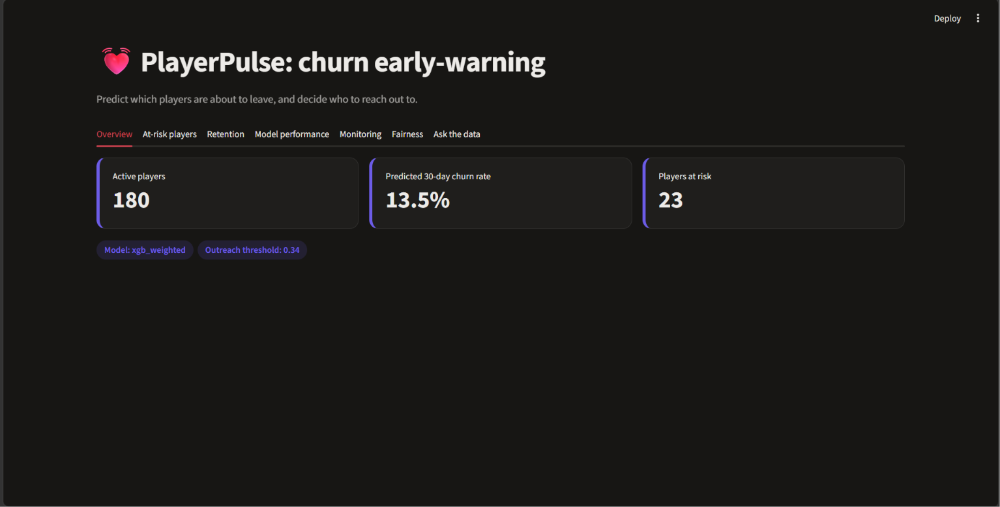
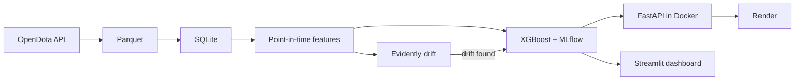

# PlayerPulse: Game Churn Early-Warning Platform


* **Live API Deployment:** `https://playerpulse-gamer.onrender.com/docs`
* **Live Interactive Dashboard:** `https://playerpulsegamer.streamlit.app/`



---

## 1. Problem Statement & Data Source

In online multiplayer games, retaining an active player base is vital to community health and monetization, making it essential to identify fading engagement before a player quits entirely. This platform evaluates historical telemetry to predict whether an active player (played $\ge 1$ match in the last 30 days) will record zero matches in the following 30 days.

**Data Source:** This project was trained and evaluated using telemetry data processed into `data/raw/matches.parquet` [FILL GAP: State plainly whether you used real OpenDota match telemetry ingested via `src/ingest.py` or the synthetic fallback generator via `src/synthetic.py`].

---

## 2. Key Results & Performance Metrics

All metrics reflect held-out temporal evaluation splits, probability calibration via Isotonic Regression, and production stress-testing under Locust load:

| Metric | Measured Value | Notes / Significance |
| :--- | :--- | :--- |
| **Test Churn Rate** | **0.1304** (13.04%) | Baseline prevalence in held-out test cutoffs |
| **Baseline PR-AUC** | **0.1581** | Dummy prior baseline performance |
| **XGBoost PR-AUC (Selected)** | **0.3612** | Chosen production model; significantly outperforms baseline |
| **PyTorch MLP PR-AUC** | **0.3638** | Deep learning baseline comparison evaluated on identical features |
| **ROC-AUC** | **0.8160** | Strong overall rank-order separation |
| **Classification Threshold** | **0.3400** | Net financial utility optimization cutoff |
| **Precision @ Threshold** | **0.3982** | Share of flagged players who actually churn |
| **Recall @ Threshold** | **0.4054** | Share of total churners successfully identified |
| **API p50 Latency** | **66 ms** | Median response latency under 20 concurrent users |
| **API p95 Latency** | **95 ms** | 95th percentile response latency under load (includes inline SHAP computation) |
| **Live Ground-Truth PR-AUC** | **0.3917** | Evaluated on post-hoc ground truth feedback across 337 scored players |

*Note on Model Selection:* While the PyTorch MLP baseline slightly edged out XGBoost in held-out test PR-AUC ($0.3638$ vs. $0.3612$), XGBoost was chosen for production deployment due to its lower latency footprint and native integration with fast tree-based SHAP explainability.

---

## 3. Architecture Diagram



---

## 4. Run It Yourself in 3 Commands

```bash
pip install -r requirements.txt
python -m src.synthetic && python -m src.run_all
streamlit run dashboard/streamlit_app.py
```

---

## 5. Limitations & Next Steps

### Limitations
* **Data Coverage:** Players with private Steam/OpenDota profiles cannot be ingested by the API crawler, potentially under-representing specific player segments.
* **Label Proxy:** Playing zero matches in 30 days is a pragmatic proxy for churn, though some inactive players may return during future seasonal updates.
* **Free-Tier Cold Starts:** Deployments hosted on Render's free tier go to sleep when idle, introducing an initial cold-start delay (~60s) on dormant instances.
* **Local Retraining:** The retrain trigger and ground-truth validation currently operate against local SQLite storage (`data/playerpulse.db`).

### Next Steps
* **Hosted Database:** Migrate local SQLite storage to a cloud PostgreSQL service (e.g., Neon or Supabase).
* **Sequence Models:** Implement a recurrent neural network (GRU/LSTM) to model raw match timestamp sequences directly.
* **Uplift Modeling:** Shift from pure risk prediction to incremental uplift modeling to optimize intervention incentives.
* **Ask the Data:** Enable natural language database queries via a TelemetryQA SQL agent tab in the dashboard.

---

## 6. Project Artifacts & Documentation

* **Model Card & Ethics Audit:** [`docs/MODEL_CARD.md`](docs/MODEL_CARD.md)
* **MLflow Tracking Dashboard:** [`docs/mlflow.png`](docs/mlflow.png)
* **SHAP Interpretability Summary:** [`docs/shap_summary.png`](docs/shap_summary.png)